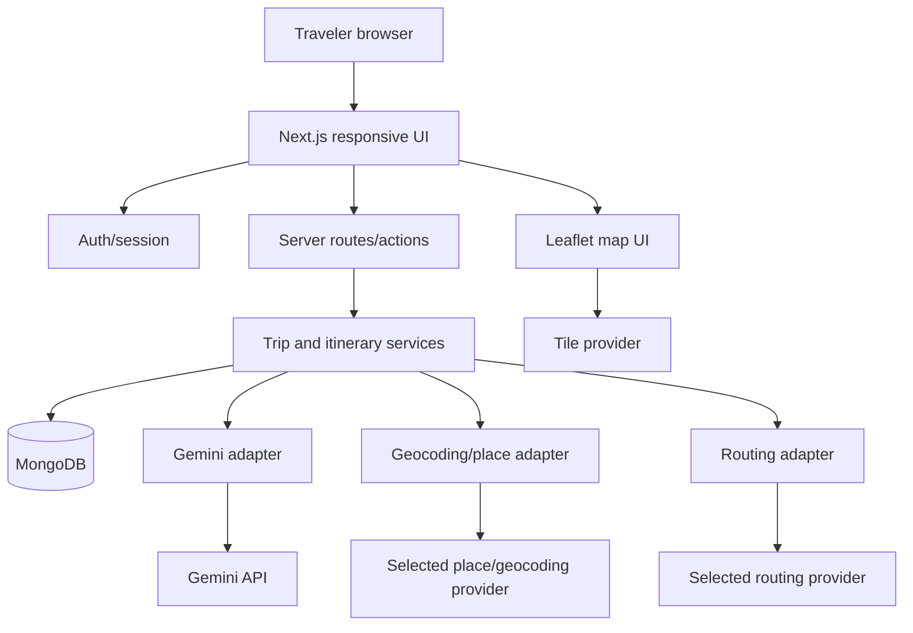

# RoamPup — MVP Architecture Plan
Version 1.0 | Proposed plan; verify against repository before implementation.

## 1. Principles
1. AI proposes; traveler decides; real map data grounds the plan.
2. Real services are authoritative for place, geocoding, route, distance and duration data.
3. Provider adapters isolate vendor-specific code.
4. Preserve user work when services fail.
5. Keep secrets server-side.
6. Inspect the existing app and implement in small verified increments.

## 2. Recommended stack
- Next.js App Router + React; TypeScript recommended, but retain existing language if repo is already established in JavaScript and migration is not justified.
- Existing styling system; if none, Tailwind CSS is a reasonable default.
- Maintained auth solution (Auth.js or comparable) supporting email/password and Google sign-in as feasible.
- MongoDB Atlas or existing MongoDB deployment, official driver or one ODM consistently.
- Gemini API through server-side adapter with configurable model/SDK.
- Leaflet + suitable OSM-compatible tile provider is a reasonable map default.
- Separate geocoding, POI search, and routing providers selected after checking current terms, quotas, costs and attribution.
- Existing lint/test tools; add schema validation such as Zod if appropriate.
- Vercel is a possible Next.js deployment target; verify current setup before changing.

**Provider gate:** document endpoint, credentials, quotas/pricing, attribution, caching/storage terms, timeouts, errors and fallback in `docs/DECISIONS.md`. Do not assume public OSM-hosted services are unlimited or production-ready.

## 3. Logical architecture

All private database access, AI calls, validation and authenticated mutations happen server-side. Browser location is permission-based and should be sent only when needed.

## 4. Suggested structure (adapt, don't blindly scaffold)
```text
app/
  (auth)/sign-in/  (auth)/sign-up/
  (app)/dashboard/  (app)/trips/new/  (app)/trips/[tripId]/
  (app)/presets/  (app)/settings/
  api/trips/  api/presets/  api/places/  api/routes/
  api/itinerary/  api/calendar/
components/{layout,dashboard,trip-form,itinerary,map,active-trip,emergency}/
lib/{auth,db,validation,providers,services,utils}/
lib/providers/{ai,geocoding,places,routing,maps}/
models/ or db/  types/  tests/
docs/{SRS.md,ARCHITECTURE.md,DECISIONS.md}
.env.example
```

## 5. Data model outline
- **User:** id, normalized unique email, display name, auth-provider reference, optional photo/phone/preferences, timestamps.
- **EmergencyContact:** id, userId, name, phone, optional relationship label.
- **TripPreset:** id, userId, name, origin, destination, preferred stops, preferences, optional vehicle, timestamps.
- **Trip:** id, userId, title, origin, destination, tripType day/multi-day, departureAt, optional returnAt, status draft/scheduled/ongoing/completed, preference snapshot, optional vehicle, optional sourcePresetId for provenance, itinerary days, route summary, timestamps/completedAt.
- **ItineraryDay:** day number/date and ordered stops.
- **ItineraryStop:** stable id, optional provider place id, name, coordinates only from verified/user source, category, stopType en-route/detour/destination-exploration, status planned/visited/skipped, optional duration/arrival/distance/detour/cost/user notes, source/provenance and availability markers.
- **RouteSummary:** provider, route profile, provider-returned distance/duration, route geometry only if terms permit, timestamp, stale/error state. Avoid GPS traces.
- **Revision draft:** base trip version, proposed stops/order, change summary, route result if available, status draft/approved/discarded. Approval is a separate action.

Trips created from presets copy values. Preset changes must not mutate existing trips. Avoid storing high-frequency location history.

## 6. API boundaries (illustrative)
- `GET /api/me`
- `GET/POST /api/presets`; `GET/PATCH/DELETE /api/presets/:id`
- `GET/POST /api/trips`; `GET/PATCH/DELETE /api/trips/:id`
- `POST /api/itinerary/generate`
- `POST /api/itinerary/alternatives`
- `POST /api/itinerary/replan` (draft only)
- `POST /api/trips/:id/revisions/:revisionId/approve`
- `GET /api/places/search`
- `POST /api/routes/compute`
- `PATCH /api/trips/:id/stops/:stopId`
- `POST /api/trips/:id/start`
- `POST /api/trips/:id/complete` (explicit confirmation)
- `POST /api/calendar/link`

Every private operation authenticates the user and checks resource ownership server-side. Validate payloads and apply limits to expensive AI/search calls.

## 7. AI generation pipeline
1. Authenticate and validate trip details.
2. Resolve origin/destination through geocoding.
3. Retrieve real candidate places and routing data.
4. Filter candidates with missing/implausible geographic data.
5. Send Gemini only structured candidates, trip constraints and preferences.
6. Require schema-conforming structured output.
7. Verify each recommendation maps to a retrieved candidate or a clearly identified custom stop.
8. Calculate/verify route distances and durations with routing provider, not Gemini.
9. Return an editable draft with data provenance and caveats.
10. User saves, edits, or discards it.

Illustrative AI draft shape:
```ts
type ItineraryDraft = {
  title: string;
  summary?: string;
  days: Array<{
    dayNumber: number;
    date?: string;
    stops: Array<{
      candidatePlaceId?: string;
      name: string;
      stopType: "en-route" | "detour" | "destination-exploration";
      reason: string;
      suggestedDurationMinutes?: number;
      estimatedCost?: {
        amount?: number;
        currency: string;
        label: "estimate" | "unavailable";
      };
    }>;
  }>;
  caveats: string[];
};
```
Adapt the final schema to repo types. Never trust AI-generated coordinates, route distance, ETA, opening hours or definitive prices.

## 8. Route/time rules
Routing provider is authoritative for distance and estimated duration. Arrival estimates may combine departure, route duration and stop duration but must be labeled estimates. Do not claim live traffic unless provider supplies it. Distinguish detour distance from route distance. Recompute after order/stop/origin/destination edits. If failed, mark fields unavailable/stale; do not show fabricated values or misleading zeroes.

## 9. Auth and privacy
- Use maintained auth and secure session settings.
- Derive user ID from verified server session; never trust client-supplied userId.
- All private queries include ownership checks.
- Test that account A cannot read/update/delete account B records.
- Keep keys in server environment variables; `.env.example` uses placeholders only.
- Avoid sending personal contacts or precise location to Gemini unless essential.
- Use request validation, safe URL handling, rate limits, bounded retries, and logs without secrets.
- Account deletion behavior must be documented.

## 10. Provider interfaces (illustrative)
```ts
interface GeocodingProvider {
  search(query: string): Promise<PlaceCandidate[]>;
  resolve(input: string): Promise<PlaceCandidate | null>;
}
interface PlacesProvider {
  nearby(input: NearbySearchInput): Promise<PlaceCandidate[]>;
  details(placeId: string): Promise<PlaceCandidate | null>;
}
interface RoutingProvider {
  computeRoute(input: RouteInput): Promise<RouteResult>;
}
interface ItineraryAIProvider {
  generateDraft(input: GroundedItineraryInput): Promise<ItineraryDraft>;
  suggestAlternatives(input: GroundedAlternativeInput): Promise<AlternativeDraft>;
}
```
Add typed errors, timeouts, validation, provider attribution and metadata where appropriate.

## 11. Failure behavior
- Gemini failure: preserve input; allow manual planning/editing; offer bounded retry.
- Invalid AI output: reject and validate; never render as trusted itinerary.
- Ambiguous geocoding: ask user to choose.
- Place search failure: preserve stops; allow custom stops.
- Routing failure: preserve edits; mark route data unavailable/stale.
- Location denied: itinerary stays available; offer manual navigation.
- Session expiry: request sign-in without exposing data.
- DB write failure: do not claim save succeeded.
- Calendar changes: warn external event may be outdated; provide updated prefilled link.

## 12. Testing
Unit: validation, stop ordering/status, preset copy, route formatting, AI schema, calendar link, completion confirmation.
Integration: auth/ownership, CRUD, mocked-provider itinerary generation, revision approval, failure preserves edits.
E2E smoke: sign-in → preset → trip draft → edit/save → active trip → mark stop → replan preview/approve → confirm completion; verify cross-account access denied.
Normal tests must mock external services rather than depend on live Gemini/OSM.

## 13. Milestones
1. Repo audit and decisions log.
2. Foundation: env validation, DB, auth, protected layout, error/loading states.
3. Dashboard and preset CRUD/copy behavior.
4. Trip creation, preferences and draft persistence.
5. Provider adapters, map, place search, routing and attribution.
6. Grounded Gemini itinerary generation and review UI.
7. Editing/replanning and explicit revision approval.
8. Active-trip screen, stop statuses, location fallback and external navigation.
9. Emergency panel and confirmed completion.
10. Calendar link, accessibility, security, tests and deployment verification.

After each milestone, run available lint/typecheck/tests/build and report exact results.
